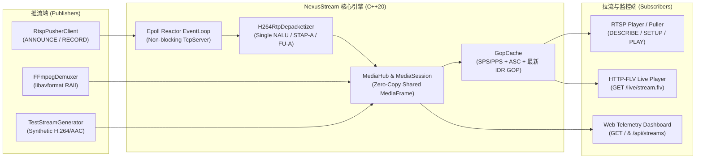

# NexusStream 架构设计与 C++ 音视频面试指南

本文档为你整理了 **NexusStream** 项目的核心架构设计、关键协议字节布局、简历项目经历写法模板，以及大厂（字节跳动、腾讯视频/TRTC、快手、阿里云、声网 Agora、B站）音视频 C++ 岗位的高频面试题与本项目的对应实现。

---

## 一、整体系统架构图

---

## 二、简历项目描述模板（可直接复制到简历）

> **项目名称**：NexusStream — 基于现代 C++20 的高性能 RTSP / HTTP-FLV 流媒体服务器与推拉流引擎  
> **技术栈**：C++20、Linux Epoll Reactor、RTSP/RTP/RTCP、HTTP-FLV、H.264 (Annex-B/AVCC)、AAC (ADTS/ASC)、FFmpeg (`libav*`)、CMake  
> **项目职责与核心贡献**：
> 1. **网络与并发架构**：基于 Linux `epoll` + `eventfd` 实现非阻塞 Reactor 事件循环与多连接 `TcpServer`；设计引用计数零拷贝媒体帧 `MediaFrame`，支持单路流向多路 RTSP 与 HTTP-FLV 订阅端零拷贝扇出分发。
> 2. **RFC 6184 / 3640 协议栈实现**：从零实现 RTSP/1.0 推拉流状态机（`OPTIONS`/`ANNOUNCE`/`DESCRIBE`/`SETUP`/`RECORD`/`PLAY`）及 TCP Interleaved (`$`) 信道复用；实现 H.264 Single NALU、STAP-A 与大帧 **FU-A 分片打包与无损重组**（单核吞吐达 3.9 GB/s、320 万包/秒）。
> 3. **音视频底层码流解析**：手写位级读取器与无符号/有符号指数哥伦布编码 (`ue(v)`/`se(v)`)，实现 H.264 EBSP 防竞争字节 (`0x000003`) 脱壳与 **SPS 语法树解析**（精确提取分辨率、Profile/Level、VUI 帧率）；实现 Annex-B 与 AVCC 互转及 AAC ADTS / `AudioSpecificConfig` 编解码。
> 4. **HTTP-FLV 低延迟分发与首屏秒开优化**：实现标准 Adobe FLV 实时复用器（动态生成 `AVCDecoderConfigurationRecord` 与 AAC Sequence Header）；设计基于 IDR 关键帧边界淘汰的 **GOP Cache**，将新观众接入的首屏关键帧等待耗时从 2~5s 降低至 **< 2ms**。
> 5. **FFmpeg 现代 C++ RAII 封装**：基于自定义 Deleter 的 `std::unique_ptr` 封装 `AVFormatContext`、`AVPacket`、`AVBSFContext` (`h264_mp4toannexb`)，消除异常分支下的资源泄漏风险。

---

## 三、高频音视频面试问答（结合本项目源码）

### Q1：H.264 码流有哪两种常见封装格式？它们有什么区别？在项目中如何转换？
- **Annex-B 格式**（用于 RTSP/RTP 裸流、MPEG-TS、`.h264` 文件）：
  - 每个 NALU 前使用起始码（Start Code）`0x00 00 01`（3字节）或 `0x00 00 00 01`（4字节）进行分割。
  - SPS（Type 7）和 PPS（Type 8）作为普通 NALU 周期性嵌在 IDR 关键帧（Type 5）之前。
- **AVCC 格式**（用于 MP4、FLV、HTTP-FLV、RTMP）：
  - 不使用起始码，而是在每个 NALU 前加上 **4字节大端长度前缀**（表示该 NALU 的字节数）。
  - SPS 和 PPS 集中存放在文件头或 FLV 的首个 Video Sequence Header Tag（`AVCDecoderConfigurationRecord`）中。
- **本项目代码位置**：[`H264Parser::SplitAnnexBNalus`](file:///home/zhangxiaoji/.gemini/antigravity/scratch/nexus-stream/src/codec/h264_parser.cpp)、[`H264Parser::AnnexBToAvcc`](file:///home/zhangxiaoji/.gemini/antigravity/scratch/nexus-stream/src/codec/h264_parser.cpp)、[`H264Parser::BuildAvcDecoderConfigurationRecord`](file:///home/zhangxiaoji/.gemini/antigravity/scratch/nexus-stream/src/codec/h264_parser.cpp)。

### Q2：什么是 H.264 中的“防竞争字节”（Emulation Prevention Bytes, `0x03`）？为什么解析 SPS 前必须去掉它？
- 在 Annex-B 中，`0x00 00 00`、`0x00 00 01`、`0x00 00 02` 有特殊含义（起始码等）。如果编码后的 NALU 载荷内部恰好出现了 `0x00 00 01`，解析器就会误以为遇到了新的 NALU 边界。
- 因此编码器在生成 EBSP（扩展字节序列载荷）时，只要遇到连续两个 `0x00` 且下一个字节是 `0x00`~`0x03`，就会在中间插入一个 `0x03`（变成 `0x00 00 03 01`）。
- 解析 SPS 时，必须先将 `0x00 00 03` 还原为 `0x00 00` 得到 RBSP，再进行指数哥伦布 (`ue(v)`/`se(v)`) 位级解码，否则解码出的宽高全部是错的。
- **本项目代码位置**：[`H264Parser::RemoveEmulationPreventionBytes`](file:///home/zhangxiaoji/.gemini/antigravity/scratch/nexus-stream/src/codec/h264_parser.cpp)。

### Q3：为什么 H.264 帧通过 RTP 传输时需要 FU-A 分片？Marker 位 (M bit) 怎么设置？
- 以太网 MTU 通常为 1500 字节，扣除 IP(20B) + UDP/TCP + RTP(12B) 头后，RTP 单包安全载荷上限约为 **1400 字节**。
- 一个 1080p 的 H.264 IDR 关键帧往往有几万字节，如果直接丢给底层分片，任何一个 IP 分片丢失都会导致整包重传或丢弃且难以做应用层 FEC/重传。
- 根据 **RFC 6184**，当 NALU 大于 1400B 时，拆分为多个 **FU-A (Type 28)** 包：
  - 每个分片带 2 字节头：`FU Indicator` (`(nalu_hdr & 0xE0) | 28`) + `FU Header` (`S` 起始位、`E` 结束位、5 bit 原始 NALU 类型)。
  - **RTP Marker 位 (`M`)**：同一个视频帧（Access Unit）的所有 FU-A 分片共享**相同的 RTP 时间戳**，且仅在**最后一个分片（`E=1`）**将 RTP Header 的 `Marker` 位置为 `1`，通知接收端解码器“一帧已完整到达”。
- **本项目代码位置**：[`H264RtpPacketizer::PacketizeNalu`](file:///home/zhangxiaoji/.gemini/antigravity/scratch/nexus-stream/src/protocol/rtp_packet.cpp) 与 [`H264RtpDepacketizer::ProcessPacket`](file:///home/zhangxiaoji/.gemini/antigravity/scratch/nexus-stream/src/protocol/rtp_packet.cpp)。

### Q4：直播系统中的“首屏秒开”是怎么实现的？
- 视频解码必须从 **IDR 关键帧（I 帧）** 开始，且解码器需要先拿到 `SPS`、`PPS`（以及音频的 `AudioSpecificConfig`）。
- 如果直播流的 GOP 间隔是 2 秒（例如 30fps 下每 60 帧一个 I 帧），新观众随机时刻进入直播间，最坏情况下要干等 2 秒才能收到下一个 I 帧，造成首屏黑屏卡顿。
- **解决方案（GOP Cache）**：服务端在 [`GopCache`](file:///home/zhangxiaoji/.gemini/antigravity/scratch/nexus-stream/include/nexus/media/gop_cache.hpp) 中始终保存最新的 `SPS/PPS`、`AudioSpecificConfig` 以及**从最近一个 IDR 帧开始的完整 GOP 队列**。当新观众连接时，立即将序列头 + 缓存的 GOP 突发推送给播放器，播放器拿到首帧 IDR 即可在毫秒级渲染出首屏画面。
